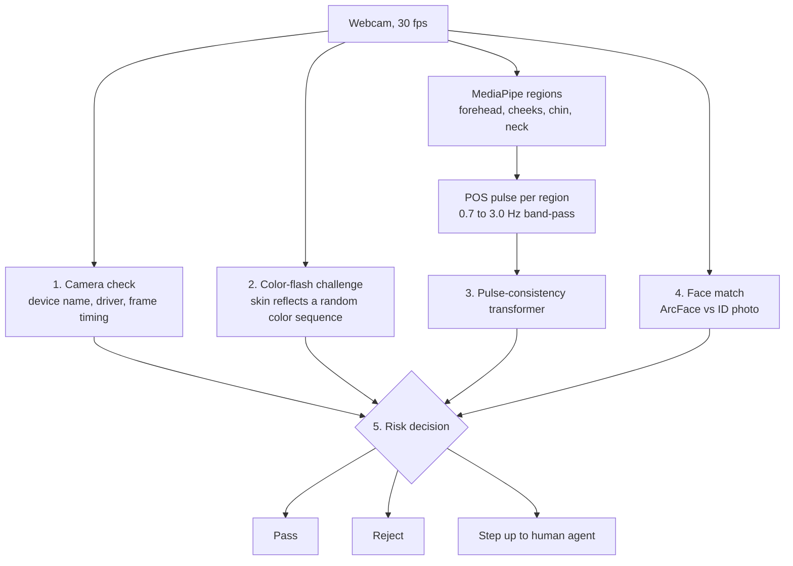

<div align="center">

# 🫀 PulseGuard

### A deepfake firewall for digital KYC onboarding

*Deepfakes have learned to fake a heartbeat. We check whether that heartbeat makes physical sense.*


[Status](#-project-status) • [Checklist](#-checklist-to-demo-day) • [Overview](#-overview) • [Architecture](#-architecture) • [Pulse model](#-the-pulse-consistency-model) • [Data](#-data) • [Getting started](#-getting-started) • [Evaluation](#-evaluation-plan) • [Demo](#-demo-plan) • [Limitations](#-limitations) • [Team](#-team)

</div>

---

## 🚦 Project status

**Last updated: Sat Oct 24, 01:55 PKT. Final: Sat Oct 24, Lahore.**

**Current stage: 🧠 Pulse training data is ready; next is training the model and building the demo app**

| # | Stage | Status | Notes |
|:---:|---|:---:|---|
| **0** | **Research and design** | ✅ Done | Five-layer firewall design is fixed (see [Architecture](#-architecture)). |
| **1** | **Training data** | ✅ Done | 449 real and 2,138 fake videos (DFDC part 0 + Google DFD), all labels checked. UBFC-rPPG not downloaded. |
| **2** | **Pulse pipeline:** video → MediaPipe regions → POS → `.npz` windows | ✅ Done | `pulse_pipeline/`. 1,976 of 2,587 videos converted into 15,363 windows (4,495 real, 10,868 fake). Live-webcam version written, not yet tested on a camera. |
| **3** | **Pulse-consistency transformer** | 🟡 Ready to train | Code in `pulse_model/`, training data ready. Not trained yet. |
| **4** | **Baselines:** CNN on PPG maps, logistic regression / XGBoost on coherence | ⚪ Not started | Needed to show the transformer helps. |
| **5** | **Other layers:** camera check, color-flash challenge, face match, risk decision | ⚪ Not started | |
| **6** | **Demo app:** mock onboarding UI with per-layer panel, ONNX export, runs offline on the laptop | 🟡 Planned | P0 for the final. Plan written in `demo_app/PLAN.md`, to be built on the laptop. No app code yet. |
| **7** | **Evaluation:** APCER / BPCER, per-attack breakdown, latency on the laptop | ⚪ Not started | |
| **8** | **Pitch:** slides, backup demo video, rehearsal, feature freeze | ⚪ Not started | Backup video must be recorded tonight. |

Legend: ✅ done · 🟡 in progress · ⚪ not started · 🔴 blocked

*Update this table whenever a stage changes.*

---

## ✅ Checklist to demo day

**Critical path:** B (model) → D (put together). Run B on the PC and C on the laptop at the same time.

### A. Pulse pipeline
- [x] Find face regions with MediaPipe (forehead, cheeks, chin, neck)
- [x] Average skin colour per region from raw frames
- [x] Turn colours into a pulse with POS, detrend and band-pass
- [x] Cut 10 s windows and save them as `.npz`
- [x] Spot-check pulse plots (`data/pulse_checks/`)
- [x] Run on all videos: 1,976 of 2,587 converted into 15,363 windows
- [x] Write the live webcam version (`pulse_pipeline/live.py`)
- [ ] Test the live version on a real webcam (on the laptop; the PC has no camera)
- [x] Investigate the 521 DFDC videos lost to face tracking: 443 come from 15 side-on recordings, looser thresholds recovered only 2 of 48, so they stay dropped

### B. Model
- [ ] Train the transformer on real windows, keeping only the 5 DFD scenes that have fakes
- [x] Group DFDC videos by actual person: all 86 DFDC originals are the same woman, so DFDC part 0 is one person (`dfdc/p00`)
- [ ] Decide how to split: with one DFDC person, a by-person split puts all of DFDC in one split. Train on DFD and use DFDC as a cross-dataset test, or download more DFDC parts
- [ ] Train the simple baseline (logistic regression on region agreement)
- [ ] Compare the two and pick the winner
- [ ] Export the winner to ONNX
- [ ] Test on the team's own 5 videos of 3 people

### C. Demo app (built on the laptop)
- [x] Write the plan (`demo_app/PLAN.md`)
- [x] Set up the GitHub repo
- [x] Push the PC's latest pipeline files (`live.py`, `pulse.py`, `extract.py`, `requirements.txt`, README)
- [ ] Clone onto the laptop and start the laptop session from `PLAN.md`
- [ ] Mock onboarding screen with a made-up bank
- [ ] Layer 1: camera check
- [ ] Layer 2: colour-flash challenge
- [ ] Layer 3: pulse slot (dummy score until B is done)
- [ ] Layer 4: face match (P2, skip if short on time)
- [ ] Layer 5: decision and per-layer panel
- [ ] Runs fully offline

### D. Put it together (needs B and C)
- [ ] Push the trained model, pull it on the laptop, plug it into layer 3
- [ ] Tune thresholds on teammates
- [ ] Run the attack ladder: photo → phone replay → live face swap
- [ ] Rehearse the finale (judge face swap)
- [ ] **Freeze features**

### E. Pitch and safety net
- [ ] Results slide with honest numbers, labelled as a pilot
- [ ] **Record the backup demo video**
- [ ] Slides and Q&A prep
- [ ] Pack the kit: ring light, charger, mock ID card, backup video on USB
- [ ] Rehearse at least twice

---

## 📌 Overview

### The problem

- SBP's 2025 Consolidated Customer Onboarding Framework requires biometric verification (fingerprint or face) before any account or wallet is activated. This includes remote onboarding.
- NADRA verification checks that the face **matches the CNIC**. A face swap is built to pass exactly that check.
- iProov's 2026 report recorded a 741% year-on-year rise in biometric injection attacks.

### Our answer

PulseGuard sits in front of face matching and asks a different question: **is this a live person in front of a real camera?**

The starting point is Intel's FakeCatcher, which reads blood-flow (PPG) signals from the face. Plain FakeCatcher is no longer enough. A 2025 Fraunhofer HHI study (*"High-quality deepfakes have a heart!"*) showed that modern face swaps inherit the driver's real pulse, so "is there a pulse?" fails. The same study found that checking whether blood flow is **spatially plausible** still catches them.

**Our core bet:** check whether pulse timing across face regions makes physical sense, and stack other cheap defenses around it.

> **Category:** AI in Fintech. Judged on applied impact, execution and a well-defended solution.

---

## 🏗️ Architecture

The user looks at the camera for about 10 seconds. Five checks run, then one decision.



| # | Layer | How it works | Catches | Misses |
|:---:|---|---|---|---|
| 1 | **Camera check** | Lists capture devices, flags known virtual cameras (OBS, ManyCam, XSplit, Snap Camera, anything "virtual"), logs frame-interval stats | Injection attacks: face-swap apps posing as a webcam | A renamed or disguised virtual camera |
| 2 | **Color-flash challenge** | Screen flashes a random sequence (e.g. 6 colors × 300 ms); cross-correlates skin color on cheeks and forehead with it, allowing up to ~150 ms lag | Printed photos, screen replays, pre-recorded deepfakes | Possibly a live face swap that carries real reflections across |
| 3 | **Pulse consistency** (our transformer) | Per-region pulse signals; checks whether timing across regions is physically plausible | Live face swaps, masks, photos (no pulse) | Unproven until tested on real data |
| 4 | **Face match** | InsightFace (ArcFace) embeddings, cosine similarity with the ID photo | A real live person who isn't the account holder | Nothing alone; it confirms *who*, layers 1–3 confirm *real* |
| 5 | **Risk decision** | Combines the layers | n/a | n/a |

**In plain words:** real camera? → live right now? → real living face? → right person?

### Decision rules

- **Reject** on any hard fail: virtual camera detected, flash challenge failed, or face mismatch.
- **Pulse model:** a high fake score rejects; a borderline score steps up to a human video agent.
- The UI shows a **per-layer panel** (pass/fail plus score) so judges can see which layer caught what.
- All thresholds live in **one config file**.

### Pipeline spec

| Step | Spec |
|---|---|
| Capture | 30 fps constant, highest quality. Lock exposure and white balance if possible. **Never JPEG-compress frames before pulse extraction.** |
| Regions | MediaPipe Face Landmarker: forehead, left cheek, right cheek, chin, neck. Neck is often hidden (hijab, collar), so it is masked, not treated as a failure. |
| Pulse | POS algorithm per region (rPPG-Toolbox), detrend, band-pass 0.7–3.0 Hz (42–180 bpm). |
| Windows | 10 s with 2 s stride for training; rolling 10 s buffer when live. |
| Export | ONNX, then INT8 with onnxruntime. Measure latency and size on the laptop. |

---

## 🧠 The pulse-consistency model

Code: [`pulse_model/`](pulse_model/). Its input comes from [`pulse_pipeline/`](pulse_pipeline/), which turns videos (or the live webcam) into per-region pulse windows.

| File | What it does |
|---|---|
| [config.py](pulse_model/config.py) | Every setting in one place, with comments. Any setting can be overridden from the command line, e.g. `--epochs 30`. |
| [model.py](pulse_model/model.py) | The transformer. |
| [data.py](pulse_model/data.py) | Loads `.npz` windows, splits **by person**, adds training-time augmentation. Input format is documented at the top. |
| [train.py](pulse_model/train.py) | Training loop, logging, best checkpoint, threshold choice and final test metrics. |
| [make_synthetic_data.py](pulse_model/make_synthetic_data.py) | Generates fake data in the exact input format, for testing the code. |

### What kind of model it is

An **encoder-only transformer classifier** (BERT / ViT family) on time series. It never sees pixels.

- **Tokens are face regions.** Each token is one region's 10 s pulse waveform (300 samples), plus 11 timing features: that region's correlation with the face-average pulse at shifts of −5 to +5 frames.
- A learned **region embedding** tells the model which region is which. There is no positional encoding because regions have no order.
- A **CLS token** collects the answer. Output is one number: the probability the window is fake.
- Missing regions (e.g. a hidden neck) are masked out of attention.
- Size: 3 layers, width 64, 4 heads, about 170k parameters. About 1 ms per window on CPU.

It is adapted from the ML lead's from-scratch LLM notebook. The attention, LayerNorm, MLP and pre-norm block are the same; PyTorch handles gradients so batching, masking and ONNX export work.

### Why the timing features were added

The original spec used the raw waveform only. At 30 fps one frame is 33 ms, and timing differences between regions are smaller than that, so they're hard to read from the waveform. On synthetic data:

| Version | Test AUC | APCER at 5% BPCER |
|---|---|---|
| Waveform only (original spec, `--xcorr_lags 0`) | 0.920 | 21.7% |
| **Waveform + timing (default)** | **0.994** | **1.3%** |
| Simple timing baseline | 0.889 | n/a |

> ⚠️ **These numbers say nothing about real performance.** The synthetic fakes were made with scrambled timing on purpose. They only show the code works and the model can read timing cues.

### How training works

1. Load all `.npz` files and split **by person**: 70% train, 15% validation, 15% test. Nobody appears in two splits.
2. Augment training windows: random region hiding (simulates a hijab over the neck), noise, gain changes. Regions are never shifted in time separately, because their relative timing is the signal.
3. Train up to 60 epochs with a class-weighted loss. Stop early if validation AUC hasn't improved for 12 epochs. Keep the best checkpoint.
4. Choose the reject threshold on **validation** so 5% of real users are rejected. Score the test set once with that fixed threshold.
5. Outputs go to `runs/<name>/`: `best.pt`, `log.csv`, `curves.png`, `metrics.json`, `test_predictions.csv`.

On the RTX 3090 a full run takes about a minute. Training time is never the bottleneck; data is.

### Input format

One or more `.npz` files in a folder:

| Array | Shape | Required | Meaning |
|---|---|:---:|---|
| `X` | `[windows, regions, samples]` | ✅ | POS pulse per region, detrended and band-passed, ≥ 300 samples |
| `y` | `[windows]` | ✅ | 0 = real, 1 = fake |
| `subject` | `[windows]` | ✅ | Whose body/pulse is on camera (for a swap: the driver video's person) |
| `mask` | `[windows, regions]` | | Which regions were visible |
| `source_subject` | `[windows]` | | For a swap: whose face was pasted on |
| `clip`, `attack`, `regions`, `fps`, `split` | | | Per-clip scores, per-attack breakdowns, forced splits |

---

## 📂 Data

### Downloaded (to `D:\DeepFake_Data`, never into git)

| Dataset | What | Size | Status |
|---|---|---|---|
| **DFDC part 0** | 1,334 ten-second videos (86 real, 1,248 face swaps), labelled in `metadata.json`, which also names each fake's source video. [Hugging Face mirror](https://huggingface.co/datasets/gonnerthetooner/DFDC-extracted-full/tree/main/dfdc_train_part_00) | 12.4 GB | ✅ |
| **Google DFD, real** | 363 real videos. [Hugging Face mirror](https://huggingface.co/datasets/Hemgg/deep-fake-detection-dfd-entire-original-dataset) | 2.9 GB | ✅ |
| **Google DFD, fake subset** | 890 face swaps from 5 still, front-facing scenes (`talking_against_wall`, `kitchen_still`, `outside_talking_still_laughing`, `secret_conversation`, `meeting_serious`). Each one's source video is in the real set. | 5.0 GB | ✅ |
| **Total** | **449 real, 2,138 fake** | 20.3 GB | |

### Converted to pulse windows (`data/pulse_windows/`, never into git)

| | Videos used | Windows | Real / fake windows |
|---|---|---|---|
| DFDC | 813 of 1,334 | 813 | 62 / 751 |
| DFD | 1,163 of 1,253 | 14,550 | 4,433 / 10,117 |
| **Total** | **1,976** | **15,363** | **4,495 / 10,868** |

`clips.csv` has a quality row for every video, and `skipped.csv` lists the ones dropped.

- **Dropped videos:** 521 DFDC clips give no window (443 of them come from 15 side-on recordings, where fewer than 3 face regions are usable), and 65 DFD clips are shorter than 10 s. Looser tracking thresholds didn't help, so this is accepted.
- **Weak signal:** on these compressed videos the pulse is near the noise floor (region agreement 0.10–0.18). It is clear on clean close-ups.
- **Scene imbalance:** 68% of DFD real windows come from scenes with no fakes (walking, hugging). Train on the 5 scenes that have fakes, or the model may learn "walking = real". Each window records its `scene`.
- **DFDC is one person:** face clustering (`pulse_pipeline/dfdc_people.py`) shows all 86 DFDC part-0 originals are the same woman, so all 813 DFDC windows carry one ID (`dfdc/p00`) and land together in one split. More people need more DFDC parts.
- **DFD walking scenes:** in 4 of 84 checked real videos (all walking scenes) the tracked face is the partner actor, so their subject label is wrong.

Both mirrors are re-uploads by individuals, not the official releases. The original research-use terms still apply.

### Original plan vs. reality

| | Planned | Actual |
|---|---|---|
| Training reals | UBFC-rPPG: 42 subjects, uncompressed, with finger-oximeter ground truth | DFDC and DFD real videos (compressed) |
| Training fakes | UBFC face swaps made on the 3090 (~125) | DFDC and DFD face swaps (compressed) |
| Local test set | ~10 consenting participants, 4 clips each, plus replay and photo attacks | 5 videos of 3 team members |

**Shortcut trap:** if reals and fakes come from different sources or compression levels, the model learns "compressed = fake". Keep real and fake from the **same dataset**, re-encode them with **identical settings**, and **split by subject**.

### Rules

- Data, videos and face images never go into git (see `.gitignore`).
- Name files by ID, never by name. Delete participant data after the event.
- Demo face match uses a **clearly labelled SAMPLE mock ID card** with a consenting teammate's photo. Never a real CNIC.

---

## 🚀 Getting started

Code lives at [fast-na-ana/aieduhackathon](https://github.com/fast-na-ana/aieduhackathon), branch `main`. Clone it outside OneDrive.

```bash
git clone https://github.com/fast-na-ana/aieduhackathon.git
```

```bash
pip install -r requirements.txt
```

### See your own pulse from the webcam

```bash
py -3.12 -m pulse_pipeline.live
```

### Test the model code on synthetic data

```bash
py -3.12 -m pulse_model.make_synthetic_data
```

```bash
py -3.12 -m pulse_model.train --data_dir data/synthetic --run_name synthetic_test
```

### Train on real data

```bash
py -3.12 -m pulse_model.train --data_dir data/pulse_windows --run_name real_v1
```

Add `--xcorr_lags 0` to train the waveform-only version for comparison.

### Not built yet

The other four layers and the demo app don't exist yet. Their plan is in [`demo_app/PLAN.md`](demo_app/PLAN.md). onnxruntime and InsightFace aren't in `requirements.txt` yet.

---

## 📊 Evaluation plan

Fintech metrics, per ISO/IEC 30107-3. The "99% accuracy" goal was dropped.

| Metric | Meaning |
|---|---|
| **APCER** | Attacks accepted. Reported at a fixed BPCER (1% or 5%). |
| **BPCER** | Real customers rejected. Blocking a real customer is a failure too. |
| Per attack type | Photo, replay, live swap, disguised virtual camera |
| Per skin tone | On the local set, Monk Skin Tone scale |
| Transformer vs. baseline | Same split |
| Latency and size | On the RTX 3050 laptop |

Per-layer scores are logged to CSV so slide numbers come straight from the logs. The local set is a **pilot** and is reported as one.

### Results

| Experiment | Result |
|---|---|
| Transformer, real data | – |
| CNN baseline | – |
| Coherence baseline | – |
| Color-flash pass rate (real vs. replay) | – |
| Latency on laptop | – |

---

## 🎬 Demo plan

**Mock onboarding app with a made-up bank brand.** No real bank names or look-alike screens.

### Attack ladder (judges pick, the per-layer panel shows what caught it)

1. **Printed photo:** no pulse, no flash response.
2. **Video replayed on a phone:** flash challenge fails.
3. **Live face swap through a virtual camera:** camera check and pulse model catch it.
4. **Disguised virtual camera:** only the pulse model can catch this. Shown as recorded results on a slide, not live.

### Finale

With the judge's consent, swap their face onto a teammate and try to onboard. It gets blocked. The judge then sits down and passes as themselves. **Delete their photo in front of them.** If the judge declines, use a teammate's face.

### Setup

- Ring light, user close to the camera, no backlight.
- Everything runs **offline** on the laptop.
- A full **backup demo video** is recorded the night before.

---

## 💻 Hardware

| Machine | Use |
|---|---|
| PC, RTX 3090 (24 GB) | Training, generating face swaps |
| Laptop, RTX 3050 (6 GB), 32 GB RAM | Demo machine, real-time inference, fully offline |

---

## ⚠️ Limitations

- **The pulse model is unproven on real deepfakes.** Its catch rate is whatever the tests show.
- **Compression hurts rPPG.** DFDC and DFD are compressed, which weakens the pulse signal.
- **Skin tone bias.** Public pulse datasets mostly cover lighter skin. Our South Asian test data is 3 people, so any per-skin-tone result is a small pilot.
- **It only knows what it's trained on.** Trained on face swaps, it catches face swaps. Photos and replays are mainly handled by the color-flash and camera checks.
- **Camera names can be changed.** The camera check is a strong signal, not proof.
- Needs about 10 seconds of a still, well-lit face.
- Output is a **risk signal for onboarding**, not proof of fraud.

---

## 🗺️ Priorities

| Priority | Items |
|---|---|
| **P0** | End-to-end demo runs reliably on the laptop: camera check, flash challenge, pulse model (or a baseline), decision, per-layer UI. Backup video recorded. |
| **P1** | Evaluation numbers for the results slide. |
| **P2** | Face match; transformer vs. baseline comparison. |
| **Skipped** | Audio challenge; any dataset that hasn't arrived. |

**Fallback:** if the transformer isn't ready or isn't better, demo with the best baseline. The layered design still carries the demo.

**Freeze features the night before, then rehearse the pitch and Q&A.**

---

## 🗣️ Pitch lines

- "Deepfakes learned to fake a heartbeat. We check whether the heartbeat makes physical sense."
- "NADRA checks your face matches your CNIC. A face swap is built to pass that. We check you're a real person in front of a real camera."
- "We report attacks let through AND real customers rejected."
- **Why not audio?** Banks are moving away from voice authentication. Pindrop saw a >1,300% rise in contact-center deepfake attempts. A spoken-digits challenge is future work.

---

## 📚 References

- FakeCatcher: https://arxiv.org/abs/1901.02212
- High-quality deepfakes have a heart! (2025): https://www.frontiersin.org/journals/imaging/articles/10.3389/fimag.2025.1504551/full
- Face Flashing: https://arxiv.org/pdf/1801.01949v1.pdf
- rPPG-Toolbox (POS): https://github.com/ubicomplab/rPPG-Toolbox
- SBP Consolidated Customer Onboarding Framework (2025): https://www.sbp.org.pk/bprd/2025/C1-Consolidated-Customer-Onboarding-Framework.pdf
- Competition: https://www.aiedu.org.pk/4th-international-ai-championship/

---

## 👥 Team

| Name | GitHub | Role |
|---|---|---|
| Abdullah Saeed | [@fast-na-ana](https://github.com/fast-na-ana) | *[Role]* |
| Umer Hassan | [@ShortBatman](https://github.com/ShortBatman) | *[Role]* |
| Omer Farooq | [@ofar00q](https://github.com/ofar00q) | *[Role]* |

Roles to assign: **ML lead** (owns the model), **integration lead** (pipeline, app, pitch), **data and evaluation** (data, attacks, evaluation, slides, backup video).

---

## 📄 License

*Add a license (for example MIT) before publishing.*

<div align="center">

Built for the **AIEF 4th International AI Championship** · AI in Fintech

</div>
