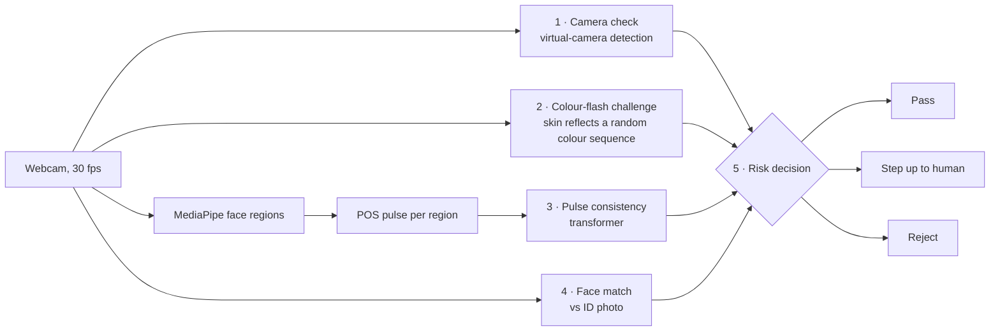

<div align="center">

# 🫀 PulseGuard

**A layered deepfake firewall for remote KYC onboarding, built around remote photoplethysmography (rPPG).**

*Deepfakes have learned to fake a heartbeat. We checked whether that heartbeat makes physical sense.*


Built for the **AIEF 4th International AI Championship** · Category: *AI in Fintech*

</div>

---

## The problem

Pakistan's State Bank requires biometric verification before any account or wallet is activated, including remote onboarding. Most remote checks confirm that the face on camera **matches the ID card**. A face swap is built to pass exactly that check.

PulseGuard asks a different question first: **is this a live person in front of a real camera?**

The original idea comes from Intel's FakeCatcher, which reads blood-flow signals from video of a face. A 2025 Fraunhofer HHI study showed that modern face swaps *inherit the driver's real pulse*, so "is there a pulse?" is no longer enough. Our bet was that the **timing of the pulse across face regions** would still give a swap away.

## What we built

| Component | Status | What it does |
|---|:---:|---|
| **rPPG pulse pipeline** (`pulse_pipeline/`) | ✅ Done | Video or webcam → MediaPipe face regions (forehead, cheeks, chin, neck) → per-region skin colour → POS algorithm → detrended, band-passed (0.7–3.0 Hz) pulse → 10 s windows saved as `.npz` |
| **Dataset processing** | ✅ Done | 2,587 videos from DFDC and Google DFD processed into **15,363 labelled windows**, with per-video quality logs and person-level grouping (face clustering) to avoid identity leakage between splits |
| **Pulse-consistency transformer** (`pulse_model/`) | ✅ Trained | Encoder-only transformer (~170k params) where **each token is a face region**: its 10 s waveform plus 11 cross-correlation timing features. Learned region embeddings, CLS token, attention masking for hidden regions |
| **Baseline** | ✅ Done | Logistic regression on region-agreement features, for an honest comparison |
| **Evaluation + ONNX export** | ✅ Done | Person-level splits, threshold fixed on validation at 5% false rejects, cross-dataset test, exported to ONNX for offline inference on a laptop |
| **Live webcam mode** | 🟡 Written | `pulse_pipeline/live.py` shows your own pulse in real time. Not yet tested on a camera |
| **Other firewall layers + demo app** | ⚪ Designed | Virtual-camera check, colour-flash challenge, face match and risk decision are fully specified in [`docs/DEMO_APP_PLAN.md`](docs/DEMO_APP_PLAN.md) but not in this repo |

## Results (an honest negative result)

The transformer reads timing cues well on synthetic data (**AUC 0.994** vs 0.920 waveform-only), which shows the architecture works. On real, compressed face-swap videos, it does not separate real from fake:

| Test set | Baseline AUC | Transformer AUC |
|---|:---:|:---:|
| Google DFD, held-out people (5 splits) | 0.59 – 0.67 | 0.45 – 0.53 |
| **536 unseen DFDC videos** (cross-dataset, ONNX path) | **0.49** | **0.50** |

**Why more training won't fix it.** A paired test (each fake against its own source video, same body, lighting and frames) shows the fake scores higher only ~50% of the time. Raw region agreement and SNR are statistically identical between real and fake. Swaps inherit the driver's pulse, and video compression erases the fine timing that is left.

**What it means for the design:** pulse analysis cannot be the face-swap detector on its own. It is downgraded to a *"live skin present"* check, and the camera check plus the colour-flash challenge carry the anti-swap job. That is the reason the firewall is layered.

## Pipeline engineering

The parts of this project that carry over to production systems:

- **Restartable, parallel extraction:** stage 1 caches per-video results and skips anything already cached, so a multi-hour run over 2,587 videos can be stopped and resumed. It runs on a process pool, and every video gets a quality row (`clips.csv`) or a reason it was skipped (`skipped.csv`).
- **Single source of config:** every hyperparameter lives in `pulse_model/config.py` and can be overridden from the command line.
- **Self-describing runs:** each training run writes `best.pt`, `log.csv`, `metrics.json`, `curves.png` and `test_predictions.csv` to `runs/<name>/`.
- **Leak-free evaluation:** splits are by person, and the decision threshold is fixed on validation before the test set is scored once.
- **Deployable artifact:** the chosen model is exported to ONNX with a JSON sidecar holding its preprocessing settings and decision threshold, and `evaluate.py` scores any data through the same ONNX path the demo uses.

## Architecture



**In plain words:** real camera? → live right now? → real living face? → right person?

## Getting started

```bash
git clone https://github.com/fast-na-ana/pulseguard.git
cd pulseguard
pip install -r requirements.txt
```

See your own pulse from the webcam:

```bash
python -m pulse_pipeline.live
```

Train and test the model end to end on synthetic data (no download needed):

```bash
python -m pulse_model.make_synthetic_data
python -m pulse_model.train --data_dir data/synthetic --run_name synthetic_test
```

Train on real data (DFDC / DFD videos downloaded locally; paths in `pulse_pipeline/datasets.py`):

```bash
python -m pulse_pipeline.extract   # videos -> data/pulse_windows/*.npz
python -m pulse_model.train --data_dir data/pulse_windows --run_name real_v1
python -m pulse_model.evaluate --windows data/pulse_windows/dfdc.npz   # score with the exported ONNX model
```

## Project structure

```
pulse_pipeline/   video & webcam -> per-region pulse windows (MediaPipe, POS, band-pass)
  ├─ extract.py       batch conversion of datasets
  ├─ live.py          real-time webcam pulse
  ├─ regions.py       face-region masks
  └─ dfdc_people.py   face clustering to group videos by real identity
pulse_model/      transformer, baseline, training, evaluation, ONNX export
  └─ export/          pulse.onnx (exported baseline)
docs/
  ├─ HACKATHON_NOTES.md   full working notes: data, checklist, experiments, pitch
  └─ DEMO_APP_PLAN.md     spec for the remaining layers and the demo app
```

## What I learned

- **Split by person, not by clip.** Random splits leak identity and inflate scores. Clustering showed all 86 DFDC part-0 originals were the same person.
- **Watch for shortcut features.** If reals and fakes come from different sources or compression levels, a model learns "compressed = fake".
- **Report the metrics that matter for the domain.** For KYC that is attacks let through (APCER) *and* genuine customers rejected (BPCER), not accuracy.
- **A clean negative result is still a result.** Testing the core hypothesis properly changed the system design for the better.

## Team

| | GitHub |
|---|---|
| Abdullah Saeed | [@fast-na-ana](https://github.com/fast-na-ana) |
| Umer Hassan | [@ShortBatman](https://github.com/ShortBatman) |
| Omer Farooq | [@ofar00q](https://github.com/ofar00q) |

## References

- Ciftci et al., *FakeCatcher: Detection of Synthetic Portrait Videos using Biological Signals* ([arXiv:1901.02212](https://arxiv.org/abs/1901.02212))
- Seibold et al., *High-quality deepfakes have a heart!* (Frontiers in Imaging, 2025) ([link](https://www.frontiersin.org/journals/imaging/articles/10.3389/fimag.2025.1504551/full))
- Tang et al., *Face Flashing: a Secure Liveness Detection Protocol* ([arXiv:1801.01949](https://arxiv.org/abs/1801.01949))
- [rPPG-Toolbox](https://github.com/ubicomplab/rPPG-Toolbox) (POS algorithm)

> Datasets (DFDC, Google DFD) are not included and remain under their original research-use terms.
