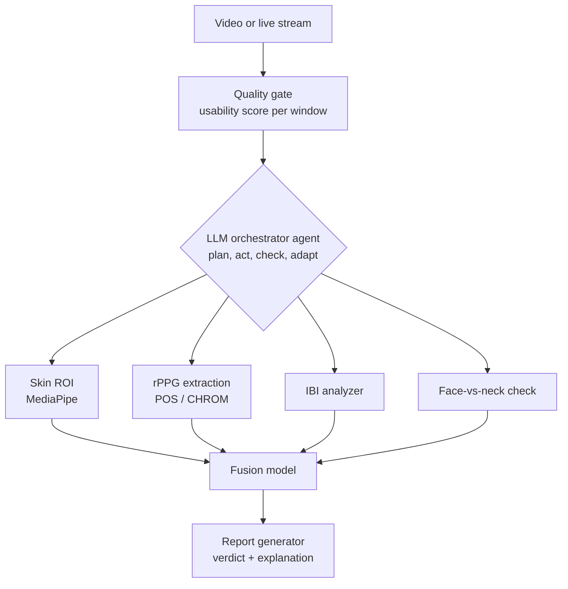

<div align="center">

# 🫀 PulseGuard

### A pulse-based authenticity agent for video

*If the person in the video is real, their heartbeat shows up in their skin. Deepfakes struggle to fake that.*


[Status](#-project-status) • [Overview](#-overview) • [How it works](#-how-it-works) • [Architecture](#-architecture) • [Features](#-features) • [Getting started](#-getting-started) • [Evaluation](#-evaluation-plan) • [Limitations](#-limitations) • [Team](#-team)

</div>

---

## 🚦 Project status

**Current stage: 🔍 Stage 0, Research**

| Stage | Focus | Status |
|:---:|---|:---:|
| **0** | **Research:** rPPG methods, datasets, prior art (FakeCatcher), agent design | 🟡 In progress |
| **1** | **Pulse pipeline:** MediaPipe ROI, POS / CHROM, bandpass, validated on UBFC-rPPG | ⚪ Not started |
| **2** | **Core checks:** face-vs-neck comparison, quality gate, IBI analysis | ⚪ Not started |
| **3** | **Agent and fusion:** LLM orchestrator, fusion model, recorded-mode report | ⚪ Not started |
| **4** | **Evaluation:** compression robustness, ablation, false-positive analysis | ⚪ Not started |
| **5** | **Live mode:** sliding window, calibration, live waveforms | ⚪ Not started |
| **6** | **Demo and pitch:** demo UI, fallback recording, rehearsal, model freeze | ⚪ Not started |

Legend: 🟡 in progress · ✅ done · ⚪ not started · 🔴 blocked

*Update this table whenever a stage changes. Finals are on Oct 24.*

---

## 📌 Overview

Deepfakes now show up in two places:

| 🔴 Live | 🎞️ Recorded |
|---|---|
| Video calls, remote onboarding and KYC, hiring interviews | Insurance claim footage, evidence clips, viral videos |

Most detectors handle only one of these, return a bare score, and give no reason for it. Pixel-artifact detectors also age badly as generators improve.

**PulseGuard** takes a different route. It looks for a physiological signal instead of visual artifacts, and it is built as an **agent** that plans, checks its own evidence, explains its verdict, and says **"inconclusive"** when the evidence is too weak.

> **Category:** AI in Fintech (fraud detection). Live mode covers video KYC; recorded mode covers claim and evidence footage.

---

## 💡 How it works

Each heartbeat changes blood volume in facial skin, causing a tiny periodic colour change. This is called **remote photoplethysmography (rPPG)**.

- A **real** face shows a coherent pulse across regions, plausible beat intervals, and a pulse that matches the neck.
- A **synthetic** face often shows no pulse, an inconsistent one, or a pulse that disagrees with the rest of the body.

### Signals we check

| Signal | Question it answers |
|---|---|
| **Per-region pulse** (forehead, cheeks) | Is there a clear peak in the 0.7 to 4 Hz band? |
| **Inter-beat intervals (IBI)** | Are intervals plausible (about 300 to 1500 ms) with natural variability, neither perfectly regular nor erratic? |
| **Cross-region agreement** | Do regions agree on rate and timing (small, stable phase lags)? |
| **Face-vs-neck mismatch** | In a face swap, the face may carry the source's pulse while the neck belongs to the target. Do they disagree? |
| **Fusion model** | A small learned model combines everything, with an ablation showing each signal's contribution. |

---

## 🏗️ Architecture



### The agent layer

The orchestrator is an LLM with tool calling. Its loop:

1. **Plan** – pick the mode and tools based on the quality gate.
2. **Act** – call tools and read structured outputs.
3. **Check** – judge whether its own evidence is strong enough.
4. **Adapt** – retry with another method, ask for better input (live only), or abstain.
5. **Report** – write the verdict with evidence.

> ⚠️ The LLM orchestrates and explains. It does **not** decide the verdict. The verdict comes from the fusion model's scores plus explicit abstain rules.

### Tools

| Tool | Input | Output |
|---|---|---|
| `quality_gate` | video / window | usability score, reasons (lighting, motion, face size, neck visibility) |
| `extract_roi` | frames | skin masks for forehead, cheeks, neck |
| `extract_pulse` | ROI signals | filtered pulse waveform per region, SNR |
| `analyze_ibi` | waveform | IBI features (mean, SDNN, RMSSD, pNN50, plausible-interval fraction) |
| `compare_regions` | waveforms | cross-region agreement, face-vs-neck rate and phase difference |
| `fuse_and_score` | all features | fake probability, per-signal contribution |
| `artifact_fallback` *(optional)* | frames | weaker frame-level fake probability |
| `write_report` | all evidence | verdict, timeline, explanation, input hash |

---

## 🎛️ Two modes

### 🎞️ Mode A: Recorded footage
Footage cannot be re-recorded, so the agent **never asks for a retake**. It works with what it has:

1. Scores every time window for usability (face size, motion, lighting, neck visible).
2. Analyses only usable windows and reports **coverage** (for example, "analysable: 38% of video").
3. Optionally falls back to a pretrained frame-artifact detector, clearly labelled as a weaker signal.
4. Outputs a timeline of suspicious segments, a verdict (*likely authentic / likely synthetic / inconclusive*), a plain-English explanation, and a **SHA-256 hash** of the input for a chain-of-custody log.

### 🔴 Mode B: Live feed
- Sliding window of about 10 s, updated every second.
- 10 to 15 s warm-up showing "calibrating".
- Live waveforms, heart-rate estimate, and a verdict that firms up over time.
- The only mode where the agent may ask the person for something ("move closer to the light", "show your neck").

---

## ✨ Features

- [ ] Skin ROI extraction (MediaPipe), POS / CHROM pulse extraction, 0.7 to 4 Hz bandpass
- [ ] Face-vs-neck pulse rate and phase comparison
- [ ] Quality gate with per-window usability and reasons
- [ ] IBI analysis branch with a learned classifier
- [ ] Fusion model with per-signal contribution
- [ ] LLM orchestrator agent (plans, retries, abstains)
- [ ] Recorded mode: timeline, verdict, explanation, coverage, SHA-256 hash
- [ ] Live mode: sliding window, calibration, live waveforms and heart rate
- [ ] Evaluation report
- [ ] Demo UI (video, waveforms, timeline, report)

> Tick these off as they get built.

---

## 🧰 Tech stack

| Layer | Tools |
|---|---|
| Vision | MediaPipe Face Mesh, OpenCV |
| Signal processing | NumPy, SciPy, POS / CHROM |
| Models | 1D CNN (waveform), gradient boosting (IBI features), logistic regression or weighted average (late fusion) |
| Backend | FastAPI, WebRTC (live mode) |
| UI | Gradio or React |
| Agent | LLM API with tool calling |

---

## 🚀 Getting started

> Update paths and commands to match the repo as it takes shape.

```bash
# clone
git clone https://github.com/<your-org>/pulseguard.git
cd pulseguard

# environment
python -m venv .venv
source .venv/bin/activate        # Windows: .venv\Scripts\activate
pip install -r requirements.txt

# configure the agent's LLM key
cp .env.example .env             # then add your API key
```

### Analyse a recorded video

```bash
python -m pulseguard.analyze --input path/to/video.mp4 --report out/report.json
```

### Run live mode

```bash
uvicorn pulseguard.server:app --reload
# open the demo UI and allow webcam access
```

### Suggested project layout

```
pulseguard/
├── pulseguard/
│   ├── quality/        # quality gate
│   ├── roi/            # MediaPipe skin regions
│   ├── pulse/          # POS / CHROM, bandpass, IBI
│   ├── compare/        # cross-region and face-vs-neck
│   ├── fusion/         # fusion model
│   ├── agent/          # LLM orchestrator and tools
│   └── report/         # verdict, timeline, hash
├── app/                # demo UI
├── eval/               # validation, compression, ablation scripts
├── data/               # datasets (not committed)
└── README.md
```

---

## 📊 Evaluation plan

We validate the pulse extractor **first**, then measure detection.

| Step | What we measure |
|---|---|
| Extractor validation | Pulse accuracy vs ground truth on **UBFC-rPPG** |
| Compression robustness | Accuracy vs compression level (ffmpeg re-encodes at several qualities) |
| Ablation | Colour only, IBI only, face-vs-neck only, all combined |
| Abstention | Inconclusive rate and coverage |
| Fairness and robustness | False-positive analysis across lighting conditions and skin tones |

**Data:** UBFC-rPPG, FaceForensics++, Celeb-DF, ffmpeg-compressed variants, and webcam footage for live testing.

### Results

*To be filled in as experiments finish.*

| Experiment | Result |
|---|---|
| UBFC-rPPG extractor error | – |
| Accuracy by compression level | – |
| Ablation | – |
| Inconclusive rate | – |

---

## 👥 Target users

- 🏦 **Banks and fintechs:** video KYC, account-opening fraud
- 🛡️ **Insurers:** claim footage
- 🔎 **Fact-checkers and investigators:** triage of one-shot footage

---

## ⚠️ Limitations

We would rather be honest about these than overclaim.

- Low-resolution or distant faces (typical CCTV) often leave too little signal.
- Heavy compression is the worst case for rPPG.
- Dark skin tones and dim lighting reduce accuracy and can raise false positives.
- A fake that copies the source pulse is only caught if the neck is visible.
- Needs roughly 10 to 30 seconds of usable footage; no frame-level verdicts.
- Output is a **triage signal, not courtroom proof**.
- Related prior art exists (for example, Intel's FakeCatcher). Our differentiators: the face-vs-neck check, the IBI branch, the abstain-and-explain agent, and support for both live and recorded modes.

---

## 🗺️ Roadmap

| Priority | Items |
|---|---|
| **Must have** | Pulse pipeline, face-vs-neck check, recorded-mode timeline and orchestrator report, honest evaluation on a small set |
| **Should have** | Live mode with sliding window, IBI classifier branch with ablation |
| **Deferred if short on time** | Fallback artifact detector, training a deep rPPG model from scratch, extra UI polish |

**Competition timeline:** shortlist Oct 16 → finals Oct 24 (model frozen two days before).

---

## 🎬 Demo flow

1. The problem: a deepfake fraud scenario (30 s)
2. **Live:** your own pulse waveform appears and the verdict firms up
3. **Recorded real clip:** timeline and explanation
4. **Recorded fake clip:** flagged, with reasons
5. **Hard clip:** heavily compressed or dim, and the agent says *inconclusive* and why
6. Close with the ablation chart and the limits

A pre-recorded fallback video is kept in case the live demo fails.

---

## 👥 Team

| Name | GitHub | Role |
|---|---|---|
| Abdullah Saeed | [@fast-na-ana](https://github.com/fast-na-ana) | *[Role]* |
| Umer Hassan | [@ShortBatman](https://github.com/ShortBatman) | *[Role]* |
| Omer Farooq | [@ofar00q](https://github.com/ofar00q) | *[Role]* |

---

## 📄 License

*Add a license (for example MIT) before publishing.*

<div align="center">

Built for the **AIEF 4th International AI Championship** · AI in Fintech

</div>
