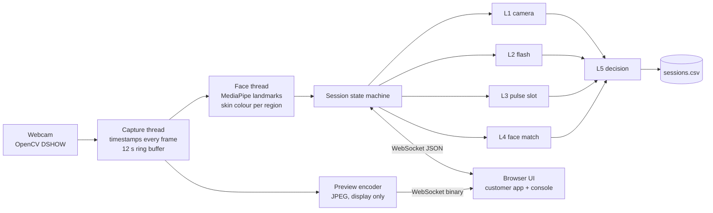

# Demo app plan (section C)

**Status:** plan only, nothing built yet. Written Fri Oct 23, 22:00 PKT. Final is Sat Oct 24.

**Who this is for:** Claude Code running **on the demo laptop** (RTX 3050, 32 GB RAM, Windows). The app is built, tested and demoed on that laptop. This file was written in a session on the training PC and reached you through the team's GitHub repo. It is the only handoff, so read it in full, together with the [README](../README.md) (project background, attack ladder, rules about faces and data).

This is the build spec for the onboarding demo: a fictional bank's account-opening flow, protected by the five PulseGuard layers, with a live per-layer panel for the judges. It does not need the pulse pipeline (A) or the trained model (B). Layer 3 has a slot that they plug into later (see [§11](#11-layer-3-slot-contract-for-a-and-b)).

---

## 0. Start here (builder on the laptop)

### How code moves: GitHub

One GitHub repo, one branch (`main`), two machines pushing to it:

- **Training PC** pushes the pulse pipeline (A), the model and its ONNX export (B), and the README.
- **This laptop** pushes `demo_app/`.
- **Demo day:** the user pulls a **fresh clone** onto the laptop and runs it from there (§12).

The two machines never edit the same files, so pushes don't conflict:

| Path | Owner | Laptop session may edit? |
|---|---|:---:|
| `demo_app/` | **this laptop session** | ✅ |
| `pulse_model/`, the pulse pipeline (A), `pulse_model/export/` (B's ONNX model) | sessions on the training PC | ❌ read only, arrives by `git pull` |
| `README.md`, `.gitignore`, top-level `requirements.txt` | the training PC | ❌ ask the user if one needs changing |

**Git routine on the laptop**

- Clone **outside OneDrive** (e.g. `C:\pulseguard\PulseGuard`). Git and OneDrive fight over the `.git` folder.
- Commit after every milestone (§13) with a message like `demo: M3 colour flash end to end`.
- Before every push: `git pull --rebase`, then `git push`. Pull also brings in A's and B's latest work.
- **Never commit** camera frames, face photos (including the ID photo), logs, the virtual environment, or the downloaded models. `.gitignore` covers these (§9). Run `git status` before each commit and check nothing unexpected is staged.
- **Ask the user before the first push** of the session (pushing publishes to the team's repo).

A and B deliver through `git pull` (see §11). Don't edit their files. If something they deliver doesn't fit, tell the user.

### First 10 minutes: check the laptop

Run these before writing any code. They check facts that were only confirmed on the other PC.

| Check | Command | Need |
|---|---|---|
| Git | `git --version`, `git remote -v` | Git installed, repo cloned outside OneDrive, remote points at the team repo |
| Python versions | `py -0p` | **3.12** (MediaPipe has no 3.14 build). Install 3.12 if missing. |
| Webcam is visible | `Get-PnpDevice -Class Camera,Image -PresentOnly` | The built-in webcam is listed. Note its InstanceId (expect `USB\VID_…`). |
| Edge | `Get-Command msedge` or check `C:\Program Files (x86)\Microsoft\Edge\Application\msedge.exe` | Present (it's the app window) |
| Screen | Settings → Display | Note resolution and scale (design for 1920×1080 and 1366×768) |
| Internet | | Needed **once** for setup downloads (§12), then never |
| Node | `node -v` | Not needed. The front end is no-build on purpose. |

Then:

1. Create the virtual environment **next to the clone, not inside it**, e.g. `py -3.12 -m venv C:\pulseguard\.venv`.
2. Install `demo_app/requirements.txt` (create it in M0, §9).
3. Confirm with the user the defaults in [§16](#16-decisions-to-confirm-with-the-user).
4. Work milestone by milestone (§13). After each one, run it with the real webcam and say what works and what doesn't.

### How to work

- **Test on a real face early.** The colour flash (M3) is the riskiest part, and it needs the user sitting in front of the laptop. Ask them to do the physical tests (their face, a phone replay, a printed photo, OBS).
- **Never add anything that changes a result by hand** (no hidden keys, no forced outcomes). The judges see the per-layer panel, and it must show what really happened.
- **The DUMMY badge stays visible** whenever layer 3 isn't a real measurement.
- **No network calls at runtime.** No CDNs, no web fonts, no telemetry, no model auto-downloads.
- **Never save camera frames to disk.** The log holds numbers only. The only stored image is the SAMPLE ID photo, which has a delete button.
- If the **frontend-design** skill is available in your session, load it before writing CSS (M6, ideally earlier). If not, follow §8.

---

## 1. Scope

| Priority | Item | In this plan |
|:---:|---|---|
| **P0** | Mock onboarding flow for a made-up bank | ✅ |
| **P0** | Layer 1, camera check | ✅ |
| **P0** | Layer 2, color-flash challenge | ✅ |
| **P0** | Layer 3 slot with a dummy score, clearly labelled DUMMY | ✅ |
| **P0** | Layer 5 decision, every threshold in one config file | ✅ |
| **P0** | Per-layer panel (pass/fail plus score) | ✅ |
| **P0** | Runs fully offline on the laptop | ✅ |
| **P1** | Pulse-presence baseline in the layer 3 slot (real signal, replaces the dummy until B lands). See [§5.3](#53-layer-3-pulse-slot) for why. | ✅ recommended |
| **P1** | Second-window console for a projector | ✅ |
| **P1** | Per-session score log (CSV) for the results slide | ✅ |
| **P2** | Layer 4, face match against a SAMPLE mock ID card | ✅ last, skip if late |
| Out | Audio challenge, mobile app, accounts, any network use | ❌ |

---

## 2. Key decisions

| Decision | Choice | Why |
|---|---|---|
| Who owns the camera | **Python** (OpenCV, DirectShow backend) | Layer 1 needs device names and hardware IDs, Layer 3 needs raw frames for A's Python pulse code, and Layer 4 runs in Python. The browser never touches the camera, so there's no permission prompt during the demo. |
| Backend | **FastAPI + uvicorn**, one process, bound to `127.0.0.1` only | Small, async WebSockets built in. Binding to localhost avoids the Windows firewall prompt. |
| Frontend | **Plain HTML, CSS and JS modules**, no build step | Nothing to install or break on the demo laptop. No CDN either: fonts, icons and scripts live in `static/`, so it works with Wi-Fi off. |
| Browser | **Edge in app mode** (`--app`, own profile, full screen), opened by the server | Edge is on every Windows 11 laptop. App mode hides the tabs and address bar. |
| Face tracking | **MediaPipe Face Landmarker (Tasks API)**, VIDEO mode | The training PC runs mediapipe 1.1.1 on Python 3.12; use the same version on the laptop. The old `mp.solutions` API is gone in recent versions, so don't copy older tutorials. It also gives iris points for face alignment. |
| Face match model | **ArcFace `w600k_r50.onnx`** from InsightFace `buffalo_l`, run with **onnxruntime** directly | The `insightface` pip package needs a C++ compiler on Windows. Alignment is about 15 lines with OpenCV. |
| Config | **`demo_app/config.toml`**, re-read at the start of every session | Thresholds can be tuned at the venue without restarting. TOML has comments and is read by the standard library. A broken file keeps the last good config and shows a warning. |
| Python | **3.12** (same as `pulse_model/`) | MediaPipe has no 3.14 build. |
| Inference device | **CPU** | Nothing here needs the GPU. Avoids CUDA setup on the laptop. |

---

## 3. Architecture



**Threads**

- **Capture thread** only reads frames and stamps them with `time.time()`. It never waits on anything else, so frame timing stays honest.
- **Face thread** runs the landmarker on the newest frame and computes mean skin colour per region on every frame using the latest landmarks. The face is still, so this keeps up even if MediaPipe skips a frame.
- **Asyncio server** runs the session, the layers and both WebSockets.

**Frames are never JPEG-compressed before analysis.** JPEG is only used for the on-screen preview. No frame is ever written to disk.

---

## 4. The session

### Customer timeline (about 15 seconds of camera time)

| Step | Customer sees | What runs |
|---|---|---|
| S0 Welcome | Bank name, "Open an account in 2 minutes", Start | |
| S1 Details | Prefilled demo form (name, date of birth, ID number `SAMPLE-…`, mobile) | |
| S2 ID on file *(P2)* | The SAMPLE mock ID card | ID photo embedding computed once |
| S3 Camera check | "Checking your camera" with a tick | **L1**: device list, hardware ID, 2 s of frame-timing stats |
| S4 Position | Live preview in a face oval. Hints: closer, more light, hold still, one face only | Quality gate: face size, centring, brightness, stillness |
| S5 Flash | "Keep looking at the screen", 3-2-1, then the **whole screen** flashes 6 colours × 300 ms | **L2**: challenge and response |
| S6 Hold still | 10 s progress ring around the oval | **L3**: 10 s window. **L4**: best frontal frame picked here |
| S7 Result | **Account opened** / **We couldn't verify you** / **Connecting you to an agent** | **L5** decision, row written to the log |

The customer screen never says *why* a check failed (a real system wouldn't tell an attacker). The console says everything.

**Run all layers.** In demo mode every layer runs even after a hard fail, so the panel shows what each layer thought. `decision.run_all_layers = false` switches to stop-on-first-fail.

### Screen layout (one 1920×1080 laptop screen)

```
┌──────────────────────────────────────┬───────────────────────────────┐
│  FALAK BANK          Protected by PG │ PULSEGUARD  session 0042  ●live│
│                                      │ ┌───────────────────────────┐ │
│      ┌──────────────────────┐        │ │ analysis view: landmarks, │ │
│      │                      │        │ │ ROI polygons, fps         │ │
│      │    ( face oval )     │        │ └───────────────────────────┘ │
│      │                      │        │ 1 CAMERA   PASS   1.00        │
│      └──────────────────────┘        │ 2 FLASH    PASS   r 0.83 ▮▮▮▮▮▯│
│      Hold still · 6 s                │ 3 PULSE    PASS   0.12 DUMMY  │
│      ━━━━━━━━━━━━━━━━━━──────        │ 4 FACE     PASS   0.61        │
│                                      │ ┌───────────────────────────┐ │
│                                      │ │ 5 DECISION     ✓ PASS     │ │
│                                      │ └───────────────────────────┘ │
└──────────────────────────────────────┴───────────────────────────────┘
                 customer app (55%)          console (45%)
```

- During S5 a full-screen colour layer covers **both** halves so the face gets the most light.
- `?view=customer` and `?view=console` open each half alone, for a projector. Every open window gets the same live state.
- Keys: `R` new session, `C` camera picker, `D` show/hide console, `F11` full screen. **No key changes a result.**

---

## 5. Layers

Every layer returns the same shape:

```python
@dataclass
class LayerResult:
    layer: int              # 1..5
    status: str             # "pass" | "fail" | "step_up" | "inconclusive" | "skipped" | "running"
    score: float | None     # the number shown in the panel
    threshold: str          # human-readable rule, e.g. "r ≥ 0.60"
    reasons: list[str]      # one line each, shown in the console
    details: dict           # layer-specific numbers for the UI and the log
    dummy: bool = False     # True → panel shows a DUMMY badge
```

### 5.1 Layer 1, camera check

**How**

1. List cameras through DirectShow with `cv2_enumerate_cameras` (name, index, path, USB VID/PID). Fallback: `pygrabber` plus `Get-PnpDevice` through PowerShell.
2. For every camera:
   - **Name match**: case-insensitive match against `camera.virtual_name_patterns` (OBS, ManyCam, XSplit, Snap Camera, anything "virtual", NVIDIA Broadcast, DroidCam, Camo, iVCam, and others).
   - **Hardware ID**: a real webcam has a USB VID/PID or a PnP hardware path. OBS-style virtual cameras are DirectShow filters with no driver, so they have none. Windows 11 software cameras show up as `SWD\…`.
3. On the selected camera, measure 2 s of frames: real fps, interval jitter, share of duplicate frames, resolution.

**Rule**

| Finding | Result |
|---|---|
| Name matches a virtual pattern | **fail** (hard) |
| No hardware ID | **step-up** by default (`camera.no_hardware_id = "soft"`; can be `"hard"` or `"off"`) |
| fps below `camera.min_fps` or duplicates above `camera.max_duplicate_ratio` | **step-up** (soft) |
| Otherwise | **pass** |

**Panel:** device name, VID:PID or "none", which pattern matched, measured fps, jitter in ms, duplicate %.

**Catches:** OBS / ManyCam / XSplit / Snap Camera. **Bonus:** the hardware-ID check may also catch a *renamed* virtual camera, which the README says only the pulse model could catch. Verify on the laptop first (its built-in camera must show a hardware ID). If it doesn't, set the rule to `"off"`.

### 5.2 Layer 2, colour-flash challenge

**Challenge**

- The **server** picks the sequence with `secrets`: 6 colours from a 6-colour palette (red, green, blue, cyan, magenta, yellow), no colour twice in a row. That's 18,750 possible sequences, so a recording can't anticipate it.
- The browser shows each colour full screen for 300 ms using `requestAnimationFrame`. It reports the actual paint time of each colour (wall-clock ms). The server and browser share the same system clock.
- A 600 ms neutral baseline comes before the first colour.

**Response measurement**

- Skin ROI = forehead + both cheeks from the landmarks (eyes, brows and mouth excluded). Mean RGB per frame.
- Convert to **chromaticity** (`R/(R+G+B)` etc.). Auto-exposure changes brightness, not colour ratios, so this stays stable if the camera adjusts exposure mid-flash.
- Skip the first `flash.settle_ms` (100 ms) of every colour.

**Score**

1. **Lag search.** For each lag from 0 to `flash.max_lag_ms` (400 ms), correlate the shown colour sequence with the measured skin chromaticity per channel. Average the channels. Keep the best lag and its correlation **r**.
2. **Per-colour check.** At the best lag, average each colour's frames and ask which palette colour it points towards. Count the correct ones out of 6.
3. **Signal strength.** Reflection size compared with the baseline noise (SNR).

**Rule**

| Finding | Result |
|---|---|
| SNR below `flash.min_snr` (too much ambient light, face too far, face lost) | **inconclusive** → step-up, customer offered a retry |
| r ≥ `flash.min_correlation` (0.60) **and** ≥ `flash.min_correct` (5 of 6) correct **and** lag ≤ max | **pass** |
| Otherwise | **fail** |

**Panel:** six swatches, *shown* above *detected*, each with ✓ or ✗; r; lag in ms; SNR. The lag is a nice talking point: a live face swap through a virtual camera adds processing delay, which shows up here.

**Expected catches**

| Attack | Expected L2 result |
|---|---|
| Phone replay | **fail**: a screen gives off its own light and barely reflects ours |
| Pre-recorded deepfake through a virtual camera | **fail**: no reflection at all |
| Live face swap | probably passes (the swap keeps real lighting), but with a larger lag |
| **Printed photo** | ⚠️ **probably passes.** Matte paper reflects coloured light much like skin. The README's attack ladder assumes otherwise. See §5.3 |

### 5.3 Layer 3, pulse slot

The slot has three interchangeable scorers, chosen by `pulse.scorer` in the config:

| Scorer | What it does | Panel badge |
|---|---|---|
| `"dummy"` **(P0)** | Returns `pulse.dummy_score`. Does not look at the video. | **DUMMY** (amber) |
| `"baseline"` **(P1, recommended)** | POS on forehead + cheeks (the same colour means L2 already computes), then "is there a clear heartbeat peak between 0.7 and 3 Hz?" (SNR of the strongest peak). No peak → high fake score. About 40 lines. | **BASELINE** |
| `"onnx"` (after A and B) | A's live pulse code + B's exported transformer | model name + version |

**Why the baseline matters:** with only a dummy, attack 1 on the ladder (printed photo) is **not caught live**. L1 passes it (real camera), L2 probably passes it (paper reflects), and a dummy L3 passes everything. "Is there a pulse at all" is weak against modern face swaps (the Fraunhofer finding), but it does catch a photo. It's also the README's fallback if the transformer isn't ready. It is a real measurement, not a staged one.

**Rule:** `p_fake ≥ pulse.reject_at` (0.70) → **fail**; `≥ pulse.step_up_at` (0.40) → **step-up**; else **pass**. If the model checkpoint carries its own threshold, `pulse.reject_at = "model"` uses it.

**Panel:** P(fake), BPM if known, the 10 s waveform, scorer name. A live waveform runs during S6 for every scorer, labelled "signal preview", so the hold-still step looks alive.

### 5.4 Layer 4, face match (P2)

- **ID side:** the SAMPLE mock ID photo is loaded from `demo_app/assets/id_photo.jpg` (git-ignored), or captured from the webcam with the operator's **Enrol ID photo** button (for the finale, with consent).
- **Live side:** the sharpest, most frontal, largest face frame from S6.
- **Align:** 5 points from MediaPipe (both iris centres, nose tip, two mouth corners) → similarity transform to the standard ArcFace 112×112 template → `w600k_r50.onnx` → 512-d L2-normalised embedding.
- **Rule:** cosine similarity ≥ `face_match.match_at` (0.45) → **pass**; ≥ `face_match.step_up_at` (0.30) → **step-up**; below → **fail**. Starting values only; tune them on the team.
- **Delete:** a **Delete biometric data** button wipes the ID photo and its embedding and shows a confirmation, for the "delete their photo in front of them" moment.
- `face_match.enabled = false` hides S2 and marks L4 **skipped**.
- The InsightFace models are for non-commercial research only. That's fine for a competition demo; say so if asked.

**Mock ID card rules:** drawn in HTML, not a scanned card. Big diagonal **SAMPLE — NOT A REAL ID** watermark, issuer "Falak Bank demo", ID number `SAMPLE-0000-0000`. No NADRA logo, no CNIC colours or layout.

### 5.5 Layer 5, decision

Applied in this order, all values from `config.toml`:

| # | Rule | Outcome |
|:---:|---|---|
| 1 | Any layer **fail** (virtual camera name, flash fail, P(fake) ≥ reject, face similarity below step-up) | **REJECT** |
| 2 | Any layer **step-up** or **inconclusive** (borderline pulse, borderline face, missing hardware ID, weak flash signal) | **STEP-UP** to a human agent |
| 3 | Everything else (skipped layers ignored) | **PASS** |

The console's decision card lists the rule that fired and every reason, e.g. *"REJECT: L1 virtual camera 'OBS Virtual Camera' (name match)"*.

---

## 6. Per-layer console panel

| Card | Status pill | Big number | Threshold shown | Detail |
|---|---|---|---|---|
| 1 Camera | PASS / STEP-UP / FAIL | | | device, VID:PID, fps, jitter, duplicates |
| 2 Flash | PASS / FAIL / INCONCLUSIVE | r | ≥ 0.60 | 6 swatches shown vs detected, lag, SNR |
| 3 Pulse | PASS / STEP-UP / FAIL + **DUMMY** or **BASELINE** badge | P(fake) | step-up 0.40 · reject 0.70 | waveform, BPM |
| 4 Face | PASS / STEP-UP / FAIL / SKIPPED | cosine | ≥ 0.45 | ID thumbnail (SAMPLE) next to live crop |
| 5 Decision | PASS / STEP-UP / REJECT | | | rule fired, reasons |

- Every card shows **running** (animated) while its layer works and fills in as soon as it finishes.
- Status is never colour alone: each pill has an icon and a word.
- A small footer shows the config file's last-modified time and a short hash, so it's clear which thresholds were used.

---

## 7. Config file (`demo_app/config.toml`, first draft)

```toml
# Every threshold and setting for the demo. Re-read at the start of every session.

[ui]
bank_name     = "Falak Bank"        # fictional; see §8
show_console  = true
open_browser  = true                # server opens Edge in app mode on start
port          = 8765

[camera]
prefer_name          = ""           # empty = first non-virtual camera
width                = 640
height               = 480
fps                  = 30
fourcc               = "YUY2"       # uncompressed if the camera supports it at 30 fps; else "MJPG"
lock_exposure        = true         # tried, not guaranteed; result is logged
lock_white_balance   = true
virtual_name_patterns = ["virtual", "obs", "manycam", "xsplit", "snap camera", "vcam",
                         "nvidia broadcast", "droidcam", "iriun", "camo", "epoccam", "ivcam",
                         "splitcam", "youcam", "altercam", "e2esoft", "webcamoid", "mmhmm",
                         "chromacam", "avatarify"]
no_hardware_id       = "soft"       # "hard" = reject, "soft" = step-up, "off" = ignore
min_fps              = 20
max_duplicate_ratio  = 0.20

[position]                          # quality gate before the flash
min_face_width       = 0.30         # fraction of frame width (closer = stronger flash reflection)
max_center_offset    = 0.15
min_brightness       = 60           # mean skin value 0-255
max_brightness       = 220
max_motion           = 0.01         # landmark movement per frame, fraction of face width
hold_ms              = 800

[flash]
num_colors           = 6
segment_ms           = 300
baseline_ms          = 600
settle_ms            = 100
palette              = ["#FF0000", "#00FF00", "#0000FF", "#00FFFF", "#FF00FF", "#FFFF00"]
max_lag_ms           = 400
min_correlation      = 0.60
min_correct          = 5
min_snr              = 3.0

[pulse]
scorer               = "dummy"      # "dummy" | "baseline" | "onnx"
dummy_score          = 0.15
window_s             = 10
reject_at            = 0.70         # or "model" to use the threshold saved by train.py
step_up_at           = 0.40
model_path           = "pulse_model/export/pulse.onnx"   # committed by the training PC (B)

[face_match]
enabled              = true
model_path           = "demo_app/models/w600k_r50.onnx"
id_photo             = "demo_app/assets/id_photo.jpg"
match_at             = 0.45
step_up_at           = 0.30

[decision]
run_all_layers       = true         # demo mode: run every layer even after a hard fail
inconclusive         = "step_up"

[log]
csv                  = "demo_app/logs/sessions.csv"   # numbers only, never images
```

---

## 8. Front-end design

**Bank:** **Falak Bank** (فلک, "sky"). A quick web search found no bank by that name; check again before the final. Footer on every screen: *"Fictional bank for a competition demo."*

**Two surfaces with different moods**

| | Customer app (Falak Bank) | Console (PulseGuard) |
|---|---|---|
| Feel | Calm, warm, trustworthy. Lots of space. One action per screen. | Precise instrument. Dense but quiet. Numbers line up. |
| Theme | Light: warm paper background, deep ink text, one warm accent | Dark graphite, thin borders, status colours only where they mean something |
| Type | Display face for headlines and the wordmark, clean sans for UI | Same sans for labels, **monospace with tabular figures** for every number |
| Motion | Gentle step transitions, a breathing ring during the hold, a calm result reveal | Cards fill in one by one, a scrolling waveform, the decision card stamps in |

**Brand pieces to make:** an original SVG mark (horizon arc and orbit, no crescent or national symbols), the wordmark, and a "Protected by PulseGuard" badge.

**Avoid:** real-bank look-alikes (no HBL teal, Meezan purple or UBL blue as the main colour), stock fintech gradients, emoji, generic card grids.

**Must work at 1920×1080 and 1366×768.** Check both.

**Build rule:** load the **frontend-design** skill before writing any CSS, if it's available in your session. Fonts (OFL licence) and icons (Lucide, ISC licence) are downloaded once into `static/` and never loaded from the internet.

---

## 9. File layout

```
demo_app/
  PLAN.md                 this file
  README.md               how to set up a fresh clone and run the demo (written in M9)
  config.toml             every threshold (§7)
  requirements.txt        demo-only deps, no torch: fastapi, uvicorn, onnxruntime,
                          opencv-python, mediapipe, numpy, cv2-enumerate-cameras
  server.py               FastAPI app, static files, both WebSockets, opens Edge
                          run: py -3.12 -m demo_app.server
  session.py              state machine S0–S7, runs the layers, writes the log
  capture.py              camera thread, ring buffer, frame stats; also plays a video file
                          (--source file.mp4) for testing without a webcam
  face.py                 Face Landmarker wrapper, ROI polygons, per-region colour, 5 keypoints
  config.py               loads and checks config.toml, keeps the last good copy
  layers/
    base.py               LayerResult
    camera_check.py       L1
    color_flash.py        L2 (scoring is pure numpy so it can be unit-tested)
    pulse_slot.py         L3 interface + dummy + baseline (+ onnx later)
    face_match.py         L4
    decision.py           L5
  static/
    index.html
    css/ tokens.css  customer.css  console.css
    js/  main.js  ws.js  flash.js  console.js  charts.js  screens/*.js
    fonts/  icons/  img/logo.svg
  tools/
    fetch_assets.py       one-time download of models + fonts (needs internet)
    run_demo.bat          double-click start on the laptop
  tests/
    test_decision.py      table of layer results → expected outcome
    test_color_flash.py   synthetic responses: correct, none, wrong order, too weak
    test_camera_names.py  virtual-name patterns
  models/   (git-ignored) face_landmarker.task, w600k_r50.onnx, filled by tools/fetch_assets.py
  assets/   (git-ignored) id_photo.jpg
  logs/     (git-ignored) sessions.csv
```

**What goes into git and what doesn't**

| Item | In git? | Why |
|---|:---:|---|
| Code, `config.toml`, `static/` (HTML, CSS, JS) | ✅ | |
| Fonts (woff2, OFL) and Lucide SVG icons (ISC) | ✅ | Small, licences allow it, and the app needs them offline |
| Logo and all UI images | ✅ **as SVG only** | The repo's `.gitignore` ignores every `.png` / `.jpg` (to keep faces out), so a PNG icon would silently go missing from the fresh clone |
| `face_landmarker.task` (3.6 MB) | ❌ | Downloaded by `fetch_assets.py` |
| `w600k_r50.onnx` (166 MB) | ❌ | **GitHub rejects files over 100 MB**, and InsightFace models are licensed for non-commercial research, so don't re-host them |
| B's `pulse_model/export/pulse.onnx` (~1 MB) | ✅ | Committed by the training PC (§11) |
| ID photo, frames, `logs/` | ❌ | Faces never go into git (README rule) |

The training PC adds these lines to the repo's `.gitignore` before the first push, so the laptop doesn't need to edit it:

```gitignore
demo_app/models/
demo_app/assets/
demo_app/logs/
*.onnx
!pulse_model/export/*.onnx
*.task
.venv/
.claude/*.lock
```

If they're missing when you clone, tell the user instead of editing `.gitignore` yourself.

---

## 10. WebSocket protocol

Two sockets: `/ws` (JSON events, both directions) and `/ws/preview` (binary JPEG frames, server → browser, display only).

**Server → browser**

| Type | Payload |
|---|---|
| `state` | `session_id`, `step` (S0…S7), `config_summary` |
| `cameras` | list of `{index, name, vid_pid, virtual_match, hardware}`; `selected` |
| `face` (~15 Hz) | `present`, `count`, `box`, `hints[]`, `ready` |
| `flash.challenge` | `colors[]`, `segment_ms`, `baseline_ms` |
| `pulse.preview` (~10 Hz) | latest waveform samples, `bpm` if known |
| `layer` | a `LayerResult` (sent as `running`, then final) |
| `decision` | `outcome`, `rule`, `reasons[]`, all five `LayerResult`s |
| `warning` | text, e.g. "config.toml has an error, using last good config" |

**Browser → server**

| Type | Payload |
|---|---|
| `session.start` / `session.reset` | demo customer details |
| `camera.select` | `index` |
| `flash.painted` | `i`, `epoch_ms` (one per colour, plus baseline start and end) |
| `id.enrol` / `id.delete` | (P2) |

With this contract fixed, the backend and the frontend can be built in parallel (one against a mock event script).

---

## 11. Layer 3 slot contract (for A and B)

```python
class PulseScorer(Protocol):
    name: str
    dummy: bool
    def score(self, window: CaptureWindow) -> LayerResult: ...

@dataclass
class CaptureWindow:
    frames: list[np.ndarray]          # raw BGR uint8 frames, never JPEG'd, ~300 for 10 s
    t: np.ndarray                     # frame timestamps in seconds (float64)
    landmarks: list[np.ndarray|None]  # MediaPipe 478×3 normalised landmarks per frame
    fps: float                        # measured, not nominal
```

A and B are built on the training PC and pushed to the repo. On the laptop, `git pull` brings them in.

**What D needs to plug in the real model**

1. **From A:** a function that turns a `CaptureWindow` into `X [regions, samples]` plus `mask [regions]`, using the same regions and filters as training.
2. **From B, committed to `pulse_model/export/`:**
   - `pulse.onnx` (about 1 MB, so it fits in git)
   - `pulse.json`: regions list, fps, `xcorr_lags`, `normalize` mode and the reject threshold chosen on validation
   - the preprocessing (`make_tokens`) in a module that **doesn't import torch**. `pulse_model/data.py` imports torch at the top, and the laptop shouldn't need it.
3. Set `pulse.scorer = "onnx"` in `config.toml`. Nothing else changes.

Until those files exist, the `"onnx"` scorer must fail loudly at startup (clear message in the console), never fall back silently to the dummy.

---

## 12. Offline setup and the demo-day fresh copy

**Downloaded once, then committed** (during M0, by the builder):

| What | From | Size |
|---|---|---|
| Fonts (woff2) and a few Lucide SVG icons | jsDelivr (fontsource, lucide-static) | < 2 MB |

**Downloaded on every fresh clone, never committed** (`tools/fetch_assets.py`, needs internet):

| What | From | Size |
|---|---|---|
| `face_landmarker.task` (float16) | storage.googleapis.com/mediapipe-models | 3.6 MB |
| `buffalo_l.zip` → keep only `w600k_r50.onnx` (P2) | github.com/deepinsight/insightface releases v0.7 | 275 MB zip, ~170 MB kept |
| Python packages | PyPI, into the venv. Also `pip download -d C:\pulseguard\wheelhouse` as a backup in case the venv has to be rebuilt at the venue with no internet | ~150 MB |

`fetch_assets.py` checks file sizes after downloading and is safe to run twice. URLs were checked on Oct 23 from the training PC: all respond.

**Running it**

- `run_demo.bat` starts the server, which opens `msedge --app=http://127.0.0.1:8765 --user-data-dir=<temp profile> --no-first-run --start-fullscreen`.
- `run_demo.bat` stops with a clear message if the models are missing ("run tools\fetch_assets.py first").

**Demo-day fresh copy** (do this the **night before**, while there's still internet, not at the venue). Write these steps into `demo_app/README.md` during M9 so the user can follow them without Claude:

1. Training PC and laptop have pushed everything. Feature freeze.
2. On the laptop, clone into a new folder outside OneDrive, e.g. `C:\pulseguard\final`.
3. Create the venv (`py -3.12 -m venv`), then `pip install -r demo_app\requirements.txt`.
4. `python demo_app\tools\fetch_assets.py`.
5. Check `config.toml`: `pulse.scorer` is the one you mean to show, and `face_match.enabled` is right.
6. Put the SAMPLE ID photo in `demo_app\assets\` (it's not in git), or plan to enrol it on stage.
7. **Wi-Fi off**, reboot, double-click `run_demo.bat`, run the whole attack ladder once.
8. Keep the old working folder untouched as a fallback until the demo is over.

---

## 13. Build order

Time estimates are for one builder. **P0 is done after M5.**

| # | Milestone | Done when | Est. |
|:---:|---|---|---:|
| M0 | Skeleton: deps, `fetch_assets`, fonts and icons into `static/`, config loader, server, static shell, WebSocket echo. First commit and push (ask the user first) | page loads from `127.0.0.1` with Wi-Fi off; `git status` shows no models or images staged | 40 min |
| M1 | Capture thread + **L1** + camera picker | OBS Virtual Camera shows as FAIL, laptop camera as PASS with VID:PID | 40 min |
| M2 | Face thread + position gate + preview with oval | hints react; ROI polygons visible in the console view | 40 min |
| M3 | **L2 flash** end to end + unit tests | a teammate passes 5 of 5 tries; a phone replay fails | 60 min |
| M4 | **L3 slot** with dummy + hold-still step + waveform preview | 10 s hold works, DUMMY badge visible | 30 min |
| M5 | **L5** + full console + result screens + CSV log | all three outcomes reachable by real attacks | 50 min |
| | **P0 cut line** | | **~4 h 20** |
| M6 | Design pass (frontend-design skill): brand, type, motion, 1366×768 check | looks finished | 60 min |
| M7 | **P1** pulse-presence baseline in the L3 slot | printed photo gets a high P(fake) | 30 min |
| M8 | **P2** L4 face match + mock ID + enrol/delete | teammate matches own ID, not another's | 60 min |
| M9 | `run_demo.bat`, `demo_app/README.md` with the fresh-copy steps, wheelhouse backup, offline test, 2 dry runs | a **fresh clone** runs the full attack ladder with Wi-Fi off, started by double-click | 50 min |

**Rules:** test L2 on a real face as early as M3, because it's the riskiest piece. If it's past the cut-off time and M8 isn't started, skip it. Freeze features when D says so.

---

## 14. Testing

**Unit tests (no camera needed):** decision table, flash scoring on synthetic signals, virtual-name matching.

**Manual matrix on the laptop** (log every run to `sessions.csv`):

| Case | L1 | L2 | L3 | L4 | Expected |
|---|---|---|---|---|---|
| Teammate, ring light on | pass | pass | pass | pass | **PASS** |
| Teammate, glasses / hijab | pass | pass | pass | pass | **PASS** |
| Teammate, dim room | pass | inconclusive? | | | **STEP-UP**, not reject |
| Printed photo | pass | **pass?** | dummy: pass · baseline: fail | | dummy: ⚠️ **PASS** · baseline: **REJECT** |
| Phone replay | pass | fail | | | **REJECT** |
| OBS + pre-recorded deepfake | fail | fail | | | **REJECT** |
| Live face swap → OBS | fail | pass, high lag | | fail if swapped face ≠ ID | **REJECT** |
| Renamed virtual camera | step-up (no HW ID) | | | | **STEP-UP** at least |
| Wrong person vs ID (P2) | pass | pass | pass | fail | **REJECT** |

Also measure: time per layer, and that the flash pass rate on real faces is ≥ 9 of 10 before demo day.

---

## 15. Risks

| Risk | Effect | Mitigation |
|---|---|---|
| Ring light or a bright room drowns the flash | L2 inconclusive for real users | Measure SNR; dim the ring light during S5; face closer (position gate); laptop brightness 100%; segment length is a config value |
| Camera auto-exposure / white balance fights the flash | colours wash out | Chromaticity scoring; try to lock exposure and white balance; 300 ms is shorter than most auto white balance reactions |
| Printed photo passes L2 | attack 1 not caught with a dummy L3 | M7 baseline, or show attack 1 only after B is in |
| Laptop camera reports no hardware ID | false step-ups | Check in M1; set `no_hardware_id = "off"` if so |
| `cv2_enumerate_cameras` doesn't work with OpenCV 5 | no device list | Fallback: `pygrabber` + PowerShell PnP query |
| Both machines push to `main` | push rejected or merge conflict | Separate folders (§0); `git pull --rebase` before every push. If a conflict touches a file outside `demo_app/`, stop and tell the user |
| A face photo or the 166 MB model gets committed | privacy breach, or GitHub rejects the push | `.gitignore` lines (§9); check `git status` before each commit; UI images SVG only |
| Fresh clone is missing something that only existed locally | app breaks on demo day | Fresh-copy rehearsal the night before (§12), with Wi-Fi off |
| Repo cloned inside OneDrive | `.git` corruption, slow | Clone to `C:\pulseguard\…` |
| A or B delivers late | layer 3 still dummy on stage | Baseline scorer (M7). The panel says DUMMY or BASELINE honestly |
| Frames dropped while MediaPipe is busy | flash or pulse window has gaps | Capture thread is independent; every frame has its own timestamp; scoring uses timestamps, not frame counts |

---

## 16. Decisions to confirm with the user

Ask these at the start, in one go. Use the default if the user has no preference.

| # | Question | Default |
|:---:|---|---|
| 1 | Bank name: keep **Falak Bank**? | Yes |
| 2 | Put the pulse-presence **baseline** in the layer 3 slot until B lands (M7)? | Yes, and build it right after M5 so the printed-photo attack is caught |
| 3 | Build the backend and the frontend in **two parallel sessions** after M0, using the §10 contract? | One session, unless the user wants speed and will watch two |
| 4 | Deadline for skipping face match (M8)? | Skip it if M8 hasn't started by the time the user sets for the backup-video recording |
| 5 | Who sits in front of the camera for the M3 flash tests? | The user |

**Already decided:**
- The app is built and run on the laptop (this machine).
- Code moves through the team's GitHub repo, not OneDrive (§0). The demo runs from a fresh clone (§12).
